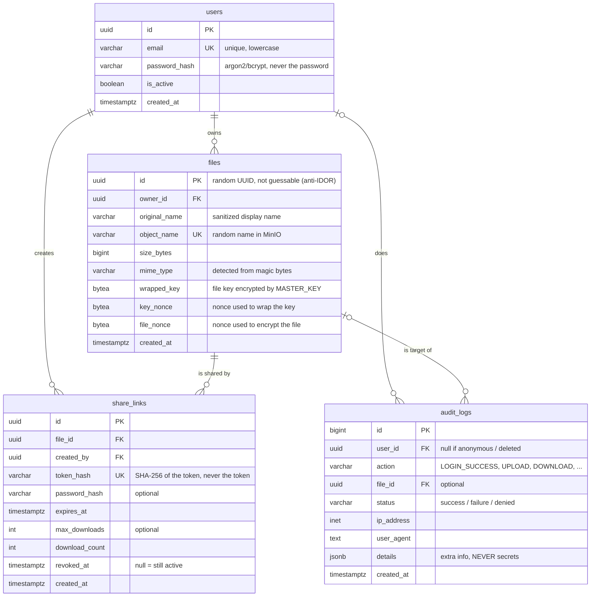

# Database design (ERD)

SecureShare uses 4 tables in PostgreSQL. The real file content is **not** in the database:
it is stored **encrypted** in MinIO. The database only keeps metadata and the *wrapped* (encrypted) file keys.

## Relationships

| Relationship | Meaning | On delete |
|---|---|---|
| users → files | one user owns many files | delete user → delete their files |
| files → share_links | one file can have many links | delete file → delete its links |
| users → share_links | who created the link | delete user → delete their links |
| users → audit_logs | who did the action | delete user → **keep the log**, user_id = NULL |
| files → audit_logs | which file was touched | delete file → **keep the log**, file_id = NULL |

## Security decisions

| Decision | Threat it stops |
|---|---|
| UUID ids instead of 1, 2, 3... | **IDOR / enumeration**: an attacker cannot guess other files' ids |
| `password_hash` only | **DB leak**: real passwords are never stored |
| `token_hash` only (SHA-256) | **DB leak**: a stolen DB does not give working share links |
| `wrapped_key` (envelope encryption) | **DB leak**: file keys are useless without `MASTER_KEY` (kept in env, not in DB) |
| random `object_name` in MinIO | **Info leak**: file names in storage reveal nothing |
| audit logs kept when user/file is deleted | **Repudiation**: actions stay provable |
| `details` JSONB never contains secrets | **Sensitive data in logs** |
| `audit_logs` is append-only (no update/delete in the API) | **Log tampering** |
